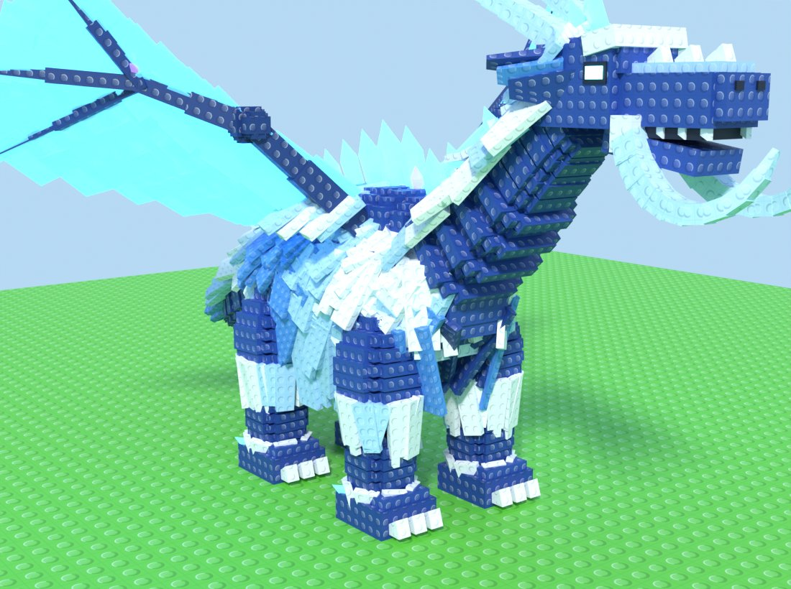
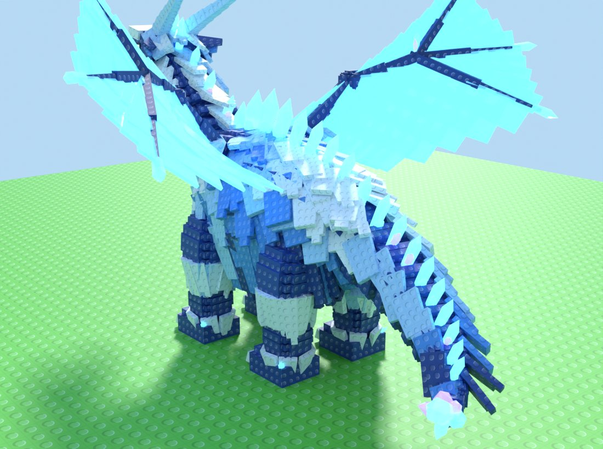
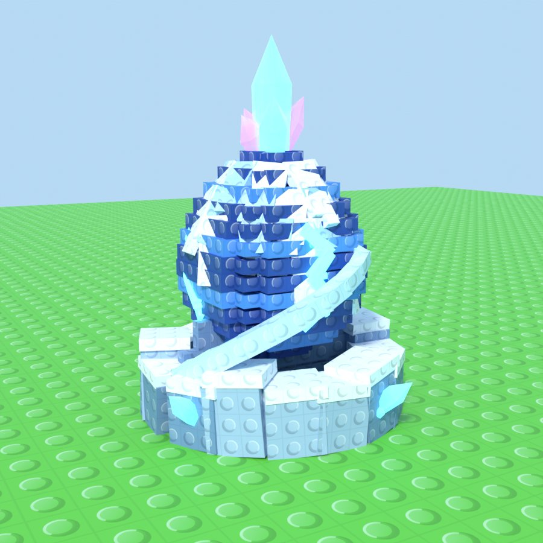
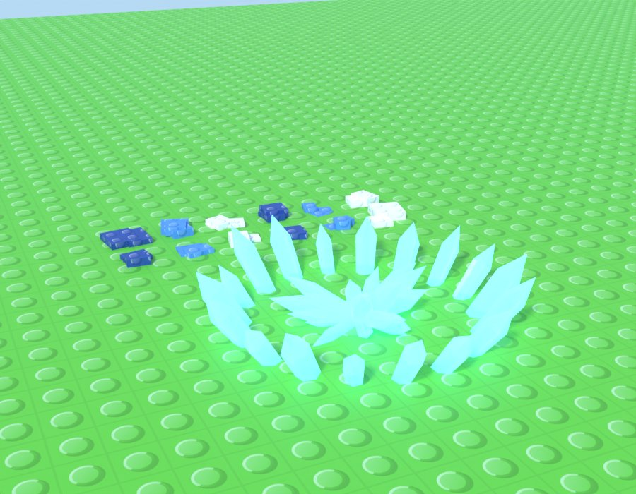

# Frostmane set: end-game Secret dragon, egg and VFX



| | |
|---|---|
|  |  |



The renders come from the generator itself: Cycles previews on a studded ground plane.

## Style

This is the blocky stud style taken from the reference monsters. Everything is built from boxes, rounded masses are stacked cross-slab layers, and every slab carries studs. The studs come from one tiling overlay texture (`StudOverlay.png`). UVs are box-projected per slab, so the studs line up with each slab like on Roblox bricks. Each colour is its own MeshPart, so the colours stay exactly on palette in Studio.

**Frostmane Wyrm** (Secret, Celestial) takes these traits from the mammoth:
- a shaggy coat of overlapping slabs in white, ice, blue and navy stripes, with a long hanging fringe and a white chest bib;
- segmented curling tusks;
- white fur cuffs on pillar legs, with white claws and crystal toes;
- glowing cyan eyes;
- crystal spikes down the spine.

The dragon parts are a long neck and snout with fangs, swept-back horns with crystal tips, translucent ice-crystal wings, and a long tail ending in a crystal cluster. It's about 19 studs tall and 33 long, with roughly 19k triangles across 14 parts.

**Frostmane Egg** (Secret, Celestial) is a stacked-slab egg in navy and blue bands with a frosted fur cap, glowing crack seams and a crystal crown. Two tusks spiral up around it from a blocky ice-rock nest. It's about 6.5 studs tall.

## Files

| File | Where it goes |
|---|---|
| `blender/GenerateFrostmaneSet.py` | Blender 4.x: paste in the Text Editor and press Alt+P (or run `blender --background --python ...`) |
| `src/ReplicatedStorage/FrostmaneVFX.lua` | ModuleScript `ReplicatedStorage.FrostmaneVFX` |
| `src/ReplicatedStorage/VFXLibrary.lua` | ModuleScript `ReplicatedStorage.VFXLibrary` (texture ids) |

The generator writes everything to `~/Documents/FrostmaneSet/`:

- `FrostmaneWyrm.glb`, `FrostmaneEgg.glb`, `FrostmaneVFXMeshes.glb` (ice nova ring, crystal burst, 12 hatch shell shards)
- `Textures/`: `StudOverlay`, `SoftGlow`, `FrostMote`, `Sparkle`, `BlockSparkle`, `BlockSnowflake`, `IceShard`, `ShockwaveRing`, `FrostMist`, `MushroomChunk`, the trail strip `FrostStreak`, and `FrostBreathFlipbook`, a 4×4 1024² flipbook rendered from a Cycles shader
- `Previews/`, `FrostmaneSet.blend`, and `FrostmaneSet_Manifest.json` (palette, per-part colours and triangle counts, socket positions)

## Studio setup

1. Stop any playtest first: changes made during Play are lost.
2. Import the three GLBs with **Import 3D**. Put the VFX meshes model in `ReplicatedStorage.VFXMeshes` and keep its name, `FrostmaneVFXMeshes`.
3. Upload the textures and paste their ids into `VFXLibrary`. Any texture that isn't uploaded yet just skips the effects that use it.
4. In the command bar (Edit mode):
   ```lua
   local FX = require(game.ReplicatedStorage.FrostmaneVFX)
   FX.Assemble(workspace.FrostmaneWyrm, "Wyrm")
   FX.Assemble(workspace.FrostmaneEgg, "Egg")
   ```
   This step:
   - sets each part's palette colour and the stud overlay (a SurfaceAppearance in Overlay mode);
   - makes the crystals and wings Glass and the eyes and cracks Neon;
   - anchors the root and welds the other parts to it;
   - turns the `Socket_*` markers into Attachments;
   - groups the glowing parts under `Glow`;
   - fills in the brief's attributes (MonsterName, Rarity, CashPerSecond, EggName, TopDrop and so on). They're placeholder numbers, so tune them.
5. At runtime:
   ```lua
   local wyrmFx = FX.StartWyrm(monster) -- glow pulse, wing sparkles, spine shimmer, foot mist, snow, breath puffs
   local eggFx = FX.StartEgg(egg, { PriceText = "$7.8B" }) -- spin and bob, crown sparkles, crack pulse, label
   FX.PlayHatch(egg, function(centre) spawnMonster(centre) end) -- wobble, flash, shards, burst, nova ring
   ```

If a model imports facing backwards, rotate its pivot 180°, or set `FACE_POSITIVE_Y = True` in the script and re-run.

## Notes

- `SurfaceAppearance.ColorMap` can only be set from Studio, so `Assemble` is a command-bar step. The runtime functions only create emitters, lights, highlights, tweens and GUI.
- The coloured parts' preview materials use a texture mix that glTF can't carry. The GLBs get flat palette materials instead, and `Assemble` reapplies the real look.
- Headless Blender 4.2 builds every asset as a collection in one scene: its glTF exporter crashes once it has switched the stub window between scenes. Running the script in the Blender UI gives one scene per asset, as the brief asks.
