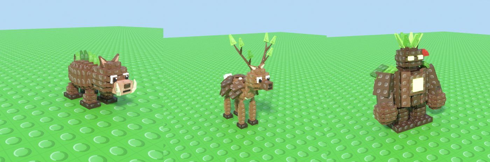
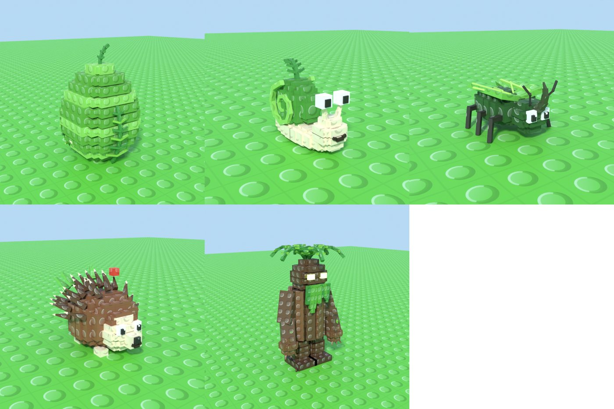
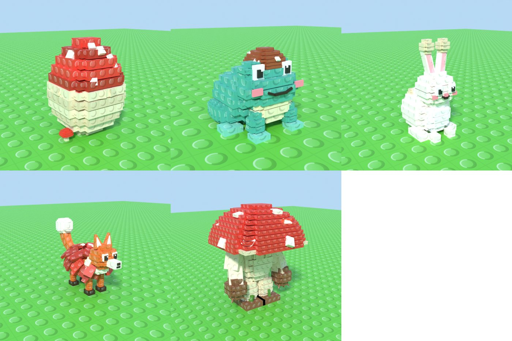
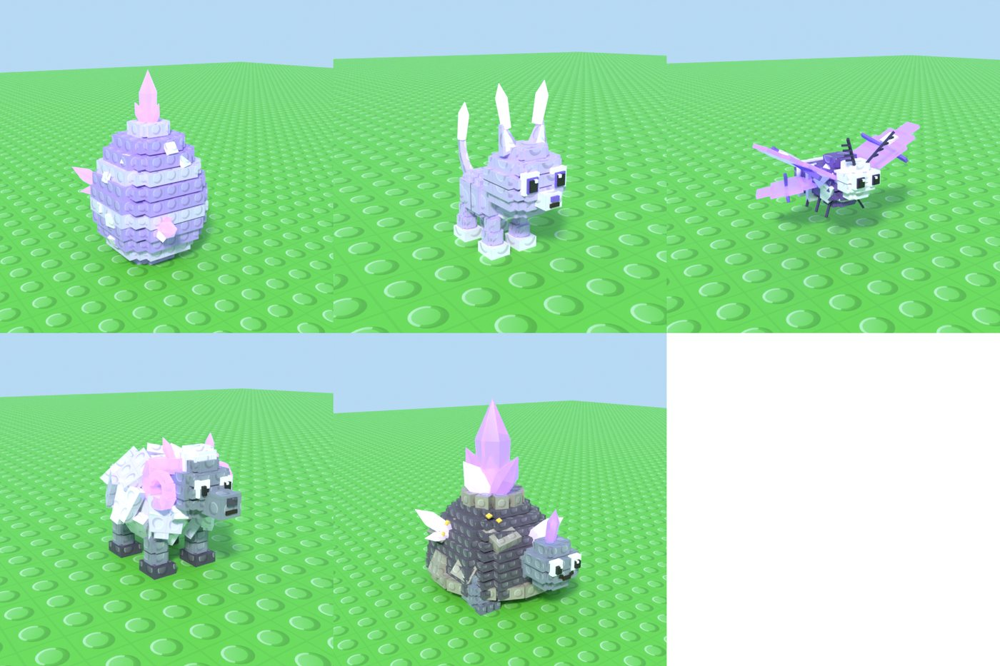
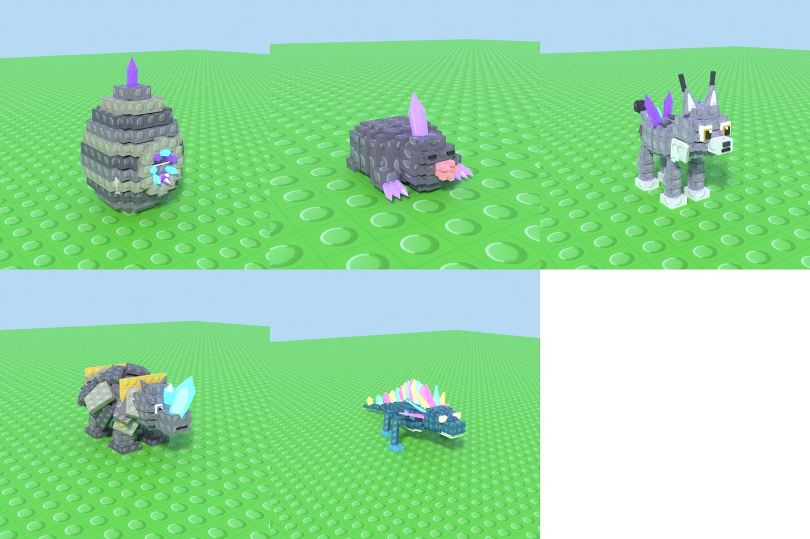
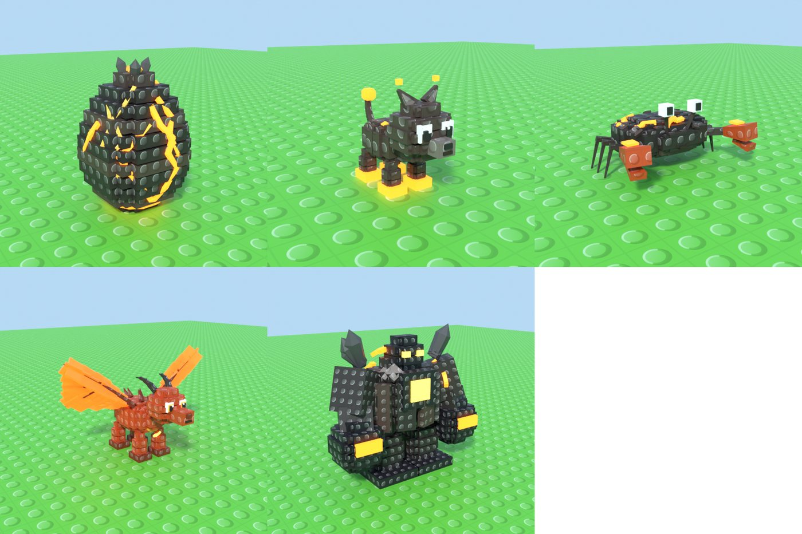
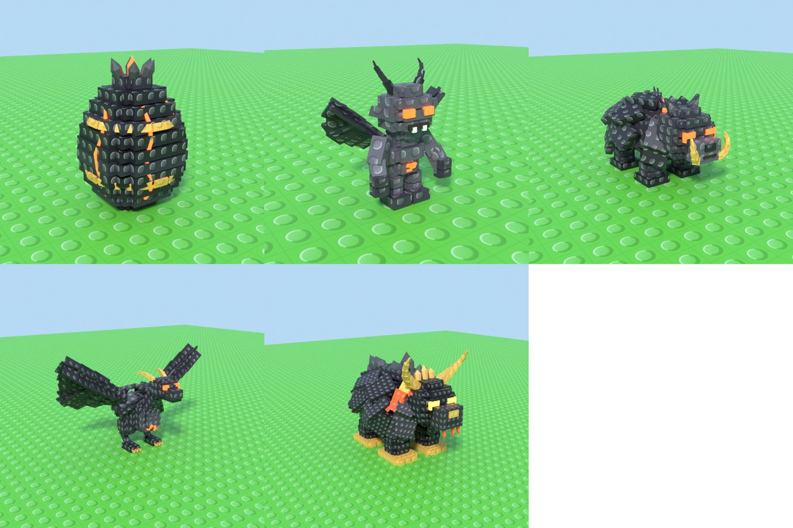
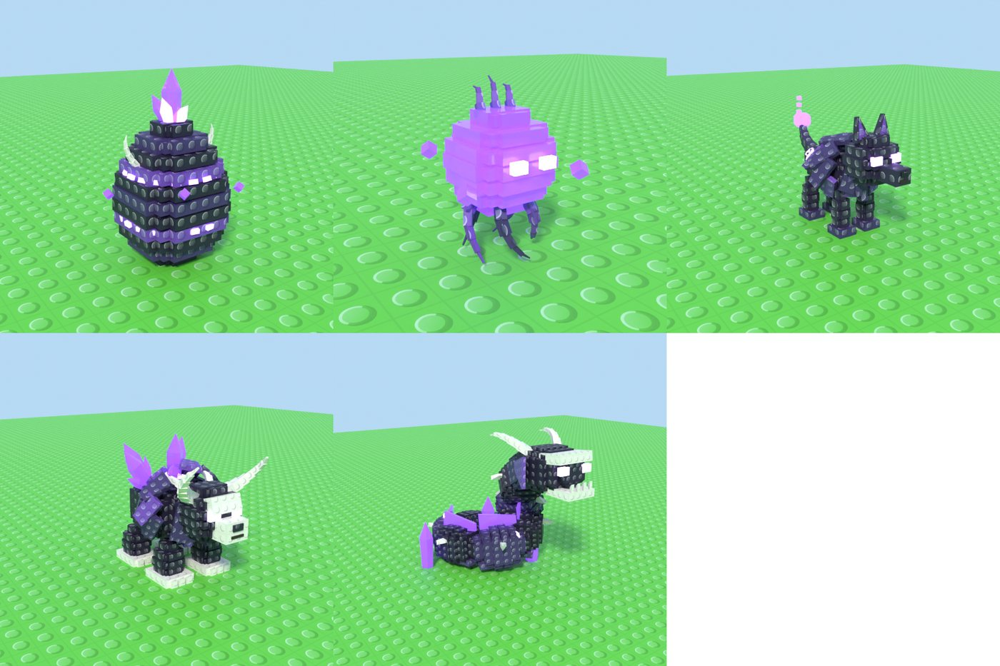
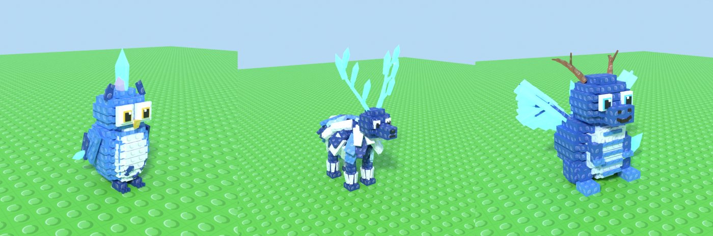

# Beginner guide: every egg and monster (the Bestiary)

This adds the other **7 eggs and 34 monsters** to your game, in the same blocky, studded style as the Mossbark Egg and Mosscap Toad. The four that already exist (Mossbark Egg, Mosscap Toad, Frostmane Egg, Frostmane Wyrm) come from the [starter](Guide_StarterSet.md) and [Frostmane](Guide_AddFrostmaneToRoblox.md) guides.

| | |
|---|---|
| **Mossbark** (no new egg) |  |
| **Fernleaf** |  |
| **Toadstool** |  |
| **Crystal** |  |
| **Geode** |  |
| **Lava** |  |
| **Obsidian** |  |
| **Void** |  |
| **Celestial** (the egg is the Frostmane Egg) |  |

**How detail follows rarity:**
- Each egg's most common monster is the plainest: a cute body, a few colours and big eyes.
- Every rarity step adds more: spots, armour plates, fur, crystals, then glowing glass and neon parts, wings and horns.
- Rarer monsters are also bigger, and rarer eggs are more decorated.
- In the game, rarer monsters get more particles, a light (Epic and up) and a glow outline (Legendary and up).

This guide is written for someone who's never used Blender or Roblox Studio. If you did the earlier guides, Parts 0 and 2 are already done.

---

## Part 0: Get the tools and files
1. Install **Blender** 4.2 or newer from <https://www.blender.org/download/>, and **Roblox Studio** from <https://create.roblox.com/>.
2. Download this project from GitHub:
   1. Pick the branch **`claude/determined-einstein-mfy9yk`** from the branch button (top left).
   2. Click **Code**, then **Download ZIP**, then unzip it.

## Part 1: Make the files in Blender
1. Open Blender and click the **Scripting** tab at the top.
2. Click **Open** in the text area, pick **`blender/GenerateBestiary.py`** from the project folder and click **Open Text**.
3. Optional, on Windows: **Window → Toggle System Console** to watch progress.
4. Click **▶ Run Script**, or press **Alt+P** with the mouse over the text.
5. **Wait 5–15 minutes.** Blender looks frozen while it builds 41 models and renders a preview picture of each. That's normal.
   - For a quicker run, set `RENDER_PREVIEWS = False` near the top of the script.
   - To build only part of it, use `ONLY = ["Lava"]` (one family) or `ONLY = ["CinderpawPup"]` (one creature).

The files go to `Documents/Bestiary/`:
- `Family_Fernleaf.glb`, `Family_Toadstool.glb`, `Family_Crystal.glb`, `Family_Geode.glb`, `Family_Lava.glb`, `Family_Obsidian.glb` and `Family_Void.glb`: each holds one egg and its four monsters, side by side.
- `Family_Mossbark.glb` and `Family_Celestial.glb`: the three new monsters for each of those eggs, with no egg.
- `BestiaryVFXMeshes.glb`: shell pieces for the hatch burst.
- `BestiaryData.lua`: every creature's colours and your game stats. The same file is already in the project at `src/ReplicatedStorage/BestiaryData.lua`.
- a `Textures` folder with pictures to upload
- a `Previews` folder

✅ **Check:** open `Previews/Family_Lava.png` and you should see the Lava Egg and its four monsters.

## Part 2: Studio basics
1. Open Studio and open your game (or a **Baseplate**).
2. **File → Publish to Roblox**. Picture uploads only work for a published game.
3. On the **View** tab, switch on **Explorer**, **Properties**, **Output** and **Command Bar**.

## Part 3: Add the scripts
How to make a script object: in **Explorer**, hover over the place it should go, click **⊕**, choose the type, then right-click it, **Rename** it, double-click it to open, select everything inside, delete it, and paste the file's contents.

| Name (exact) | Type | Goes in | Paste this file |
|---|---|---|---|
| `VFXLibrary` | ModuleScript | ReplicatedStorage | `src/ReplicatedStorage/VFXLibrary.lua` |
| `BestiaryData` | ModuleScript | ReplicatedStorage | `src/ReplicatedStorage/BestiaryData.lua` |
| `CreatureKit` | ModuleScript | ReplicatedStorage | `src/ReplicatedStorage/CreatureKit.lua` |
| `BestiaryDemo` | Script | ServerScriptService | `src/ServerScriptService/BestiaryDemo.lua` |

If you already have `VFXLibrary` from an earlier guide, **replace its contents** with the newest file, which has three more lines (`Ember`, `VoidWisp`, `Glint`). Then paste your existing IDs back in.

## Part 4: Upload the pictures
1. Open **View → Asset Manager** and click **Bulk Import**.
2. Go to `Documents/Bestiary/Textures` and select these files:
   - `Ember.png`
   - `VoidWisp.png`
   - `Glint.png`
   - `StudOverlay.png` (skip it if you uploaded it in an earlier guide)
3. In Asset Manager → **Images**, right-click each one, choose **Copy Asset ID**, and paste it into the matching line of `VFXLibrary`. For example, `Ember = "rbxassetid://123456789",`.

The bestiary also uses pictures from the earlier guides:
- **From the starter set:** `Spore`, `LeafBit`, `DustPuff`.
- **From the Frostmane set:** `Sparkle`, `FrostMote`, `IceShard`, `ShockwaveRing`.

If you haven't done those guides, run `GenerateStarterSet.py` and `GenerateFrostmaneSet.py` in Blender and upload those pictures too. Anything still at `rbxassetid://0` is simply skipped: the creatures work, just with fewer sparkles.

✅ **Check:** the `Ember`, `VoidWisp`, `Glint` and `StudOverlay` lines no longer say `rbxassetid://0`.

## Part 5: Import the models
Use **File → Import 3D** (in some Studio versions it's on the **Home** or **Avatar** tab). Keep the default settings and click **Import**.

Import all **ten** files from `Documents/Bestiary`, one at a time:
- the nine `Family_….glb` files;
- `BestiaryVFXMeshes.glb`.

Leave each import directly in **Workspace**, and don't rename the parts inside them. The setup in Part 6 recognises them by their part names, so it doesn't matter what Studio calls the imported models.

## Part 6: Run the one-time setup
1. Make sure you're **not** playing (click **Stop** if you see it).
2. Paste this line into the **Command Bar** and press **Enter**:
   ```lua
   require(game.ReplicatedStorage.CreatureKit).SetupAll()
   ```
3. **Output** shows one `Assembled …` line per creature, then a final line:
   `SetupAll: 7 eggs -> Workspace.Bestiary, 34 monsters -> ServerStorage.Bestiary, shards -> ReplicatedStorage.VFXMeshes`

What it did:
- split each family into one model per creature, named after it (for example `CinderpawPup`);
- gave them their colours and studs, and set their stats as **Attributes**;
- put the **eggs** in a folder **Workspace → Bestiary**;
- put the **monsters** in **ServerStorage → Bestiary**, where the demo copies them from when an egg hatches;
- put the shell pieces in **ReplicatedStorage → VFXMeshes**.

✅ **Check:** the eggs in Workspace have their proper colours and little studs. Use the **Move** tool to place them wherever you like; keep them inside the `Bestiary` folder.

**Optional showcase:** to see monsters standing in the world, drag any of them from `ServerStorage → Bestiary` into `Workspace → Bestiary`. This is the only way to see the Mossbark and Celestial monsters in the demo, because their eggs come from the other guides. Drag a **copy** (Ctrl+D first) if you also want to keep it as a hatch template.

## Part 7: Try it
1. Press **Play** (F5).
2. The eggs rock on the ground with sparkles, embers or wisps, and a label shows the name, rarity and price.
3. **Click an egg.** It wobbles, flashes and bursts into shell pieces in its own colours, and a monster from that egg appears next to it. Which monster you get follows your hatch chances, so the common one appears most often.
4. After 10 seconds the monster goes away and the egg is ready again.
5. To see the rare ones more often, set `local LUCK = 1` to `3` near the top of `BestiaryDemo`.
6. Click **Stop** when you're done.

---

## Troubleshooting

| Problem | Fix |
|---|---|
| `SetupAll: 0 eggs … 0 monsters` | The imports aren't directly in Workspace (for example, they're inside a folder). Drag them into Workspace and run Part 6 again. |
| `Unpack left N unrecognised parts` | That import has parts from an older or newer Blender run than your `BestiaryData`. Re-run the Blender script, paste the new `Documents/Bestiary/BestiaryData.lua` into the `BestiaryData` script, delete the old imports, and redo Parts 5 and 6. |
| `no BestiaryData entry for …` | Same fix as above: `BestiaryData` and the `.glb` files must come from the same run. |
| No studs on the creatures | `StudOverlay` isn't uploaded or pasted (Part 4). Then delete the `Bestiary` folders, re-import and run Part 6 again. |
| `SurfaceAppearance needs Studio` | You ran the setup while playing. Stop and run it again. |
| `Infinite yield … Bestiary` | The demo needs both `Workspace.Bestiary` and `ServerStorage.Bestiary`. Run Part 6 first. |
| No particles at all | The pictures aren't uploaded yet (Part 4). Output shows one warning per missing picture. |
| A monster appears inside a wall | The demo puts it to the right of the egg (+X). Leave some space there. |
| Blender looks frozen | It's building and rendering. Wait up to 15 minutes, or set `RENDER_PREVIEWS = False`. |
| A red error in Blender | Open the text called `Bestiary_Log` in the text area's **Text** menu and send me the error. |

## Where to change numbers
- **Hatch chances, Cash/s, Strength and Luck multipliers, hatch time, sell price and drop areas** are in the `FAMILIES` table of `blender/GenerateBestiary.py`. Change them there and re-run it, so `BestiaryData` stays in sync. To try a number quickly, select a creature in Studio and edit its **Attributes**.
- **Follower bonus** (extra WalkSpeed and Cash for the monster following you) is `CreatureKit.FOLLOWER_BONUS`. Common is +1 speed and +5% Cash; Secret is +12 speed and +150% Cash. The steps in between are a smooth curve you can tune. Each monster also gets `FollowerWalkSpeed` and `FollowerCashBonus` attributes.
- **Effects per theme** (particle picture, colours, light colour) are `CreatureKit.THEMES`.
- **Rarity label colours** are `CreatureKit.RARITY_COLORS`.

## For your own scripts
```lua
local K = require(game.ReplicatedStorage.CreatureKit)
local asset = K.RollHatch("Lava", playerLuck)   -- e.g. "CinderpawPup"
local monster = game.ServerStorage.Bestiary[asset]:Clone()
monster.Parent = workspace
local effects = K.StartMonster(monster)          -- later: effects.Stop()
print(K.FollowerBonus(monster:GetAttribute("Rarity")).WalkSpeed)
```
