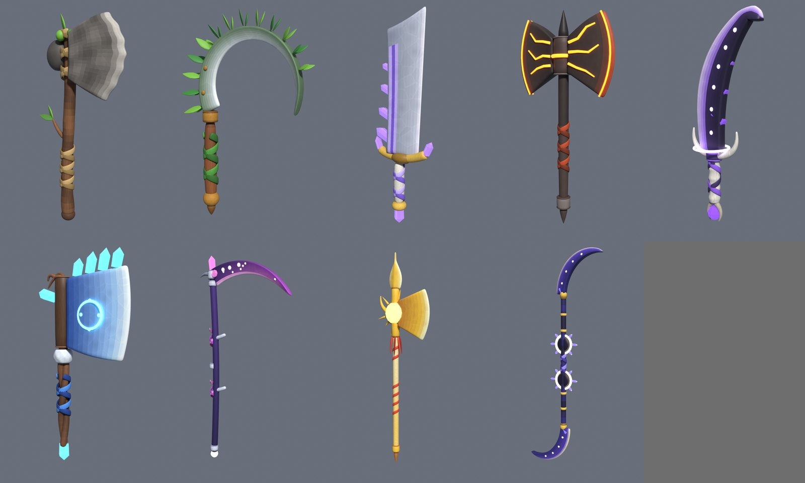

# Beginner guide: the choppers (all 10 weapons)



The Mossbark Hatchet (the starter axe) comes from the [starter set guide](Guide_StarterSet.md). This guide adds the other nine choppers. They're in the same **smooth, hand-painted cartoon style**: no studs, a painted texture on each part, and glowing Neon or Glass parts on the higher tiers.

| # | Chopper | Tier | Type | Strength per hit | Cash price | Robux | Look |
|---|---|---|---|---|---|---|---|
| 1 | Mossbark Hatchet | Wood | Axe | +1 | Free (starting chopper) | – | Steel hatchet, green leather wraps (starter set) |
| 2 | Stonebark Hatchet | Wood | Axe | +5 | $500 | 15 R$ | Knapped stone head lashed with rope to a bent branch |
| 3 | **Fernleaf Sickle** *(new)* | Wood | Sickle | +20 | $15K | 29 R$ | Crescent sickle with a fern frond along its back |
| 4 | Amethyst Chopper | Crystal | Sword | +60 | $250K | 49 R$ | Broad cleaver-sword, amethyst stripe, crystals on its spine |
| 5 | Magmaseam Axe | Lava | Axe | +600 | $50M | 99 R$ | Double-bladed basalt axe split by glowing magma seams |
| 6 | Voidglass Reaver | Void | Sword | +5,000 | $10B | 199 R$ | Hooked void-stone blade, bone hilt, void orb pommel |
| 7 | Frostroot Cleaver | Celestial | Axe | +25,000 | $1T | 399 R$ | Huge ice cleaver on twisted roots, glowing rune circle |
| 8 | **Stardust Scythe** *(new)* | Nebula | Scythe | +150,000 | $80T | 599 R$ | Long scythe, nebula-pink blade scattered with stars |
| 9 | **Sunburst Halberd** *(new)* | Solar | Halberd | +900,000 | $5Qa | 799 R$ | Gold halberd with a glowing sun disc and flame tassels |
| 10 | **Eclipse Glaive** *(new)* | Astral | Glaive | +5,000,000 | $300Qa | 999 R$ | Twin moon blades held between two eclipse rings |

**About the four new choppers:** they fill the list up to 10. Their stats and prices are placeholders that continue your curve. The Fernleaf Sickle bridges the jump from +5 to +60, and the three cosmic ones match the Nebula, Solar and Astral eggs. To change them, edit the `CHOPPERS` table near the bottom of `blender/GenerateChoppers.py` and run it again.

This guide is written for someone who's never used Blender or Roblox Studio. If you did the earlier guides, Parts 0 and 2 are already done.

---

## Part 0: Get the tools and files
1. Install **Blender** 4.2 or newer from <https://www.blender.org/download/>, and **Roblox Studio** from <https://create.roblox.com/>.
2. Download this project from GitHub:
   1. Pick the branch **`claude/determined-einstein-mfy9yk`** from the branch button (top left).
   2. Click **Code**, then **Download ZIP**, then unzip it.

## Part 1: Make the files in Blender
1. Open Blender and click the **Scripting** tab at the top.
2. Click **Open** in the text area, pick **`blender/GenerateChoppers.py`** and click **Open Text**.
3. Click **▶ Run Script** (or **Alt+P** with the mouse over the text).
4. **Wait 5–15 minutes.** Blender looks frozen while it paints and bakes a texture for every part. That's normal.
   - For a quicker run, set `RENDER_PREVIEWS = False` near the top.
   - To rebuild just one chopper, use `ONLY = ["MagmaseamAxe"]`.

The files go to `Documents/Choppers/`:
- `Choppers.glb`: all nine choppers side by side, with their painted textures built in.
- `ChopperData.lua`: every chopper's stats, prices and grip. The same file is already in the project at `src/ReplicatedStorage/ChopperData.lua`.
- `Previews/`: a picture of each chopper, plus `Choppers_Lineup.png` with all of them.

✅ **Check:** open `Previews/Choppers_Lineup.png` and you should see all nine.

## Part 2: Studio basics
1. Open Studio and open your game (or a **Baseplate**).
2. **File → Publish to Roblox**. Uploads only work for a published game.
3. On the **View** tab, switch on **Explorer**, **Properties**, **Output** and **Command Bar**.

## Part 3: Add the scripts
How to make a script object: in **Explorer**, hover over the place it should go, click **⊕**, choose the type, then right-click it, **Rename** it, double-click it to open, select everything inside, delete it, and paste the file's contents.

| Name (exact) | Type | Goes in | Paste this file |
|---|---|---|---|
| `VFXLibrary` | ModuleScript | ReplicatedStorage | `src/ReplicatedStorage/VFXLibrary.lua` |
| `ChopperData` | ModuleScript | ReplicatedStorage | `src/ReplicatedStorage/ChopperData.lua` |
| `ChopperKit` | ModuleScript | ReplicatedStorage | `src/ReplicatedStorage/ChopperKit.lua` |
| `ChopperDemo` | Script | ServerScriptService | `src/ServerScriptService/ChopperDemo.lua` |

For the swing animations you also need `AnimationConfig` (ModuleScript in ReplicatedStorage) and `AnimationController` (LocalScript in StarterPlayer → StarterPlayerScripts) from [PlayerAnimations.md](PlayerAnimations.md). If you already have `AnimationConfig`, **replace it** with the newest file, which knows the new weapon types (Sickle, Scythe, Halberd, Glaive).

## Part 4: Pictures for the effects
The choppers reuse pictures you may have uploaded in the earlier guides:
- **Swing trail:** `SwingStreak` (starter set).
- **Sparkles per tier:** `Sparkle`, `FrostMote` (Frostmane set), and `Ember`, `VoidWisp`, `Glint` (bestiary).

Anything still at `rbxassetid://0` in `VFXLibrary` is skipped: the choppers still work, just without that sparkle or trail. Wood choppers have no sparkles.

## Part 5: Import the choppers
1. **File → Import 3D**, pick `Documents/Choppers/Choppers.glb`.
2. Make sure **Upload to Roblox** is on in the import window (it uploads the painted textures), then click **Import**.
3. Leave the imported model directly in **Workspace**. Its name doesn't matter.

## Part 6: Run the one-time setup
1. Make sure you're **not** playing.
2. Paste this line into the **Command Bar** and press **Enter**:
   ```lua
   require(game.ReplicatedStorage.ChopperKit).SetupAll()
   ```
3. **Output** shows one `Made ReplicatedStorage.Choppers.…` line per chopper, then:
   `SetupAll: 9 choppers -> ReplicatedStorage.Choppers`

✅ **Check:** **ReplicatedStorage → Choppers** has nine Tools, from *Stonebark Hatchet* to *Eclipse Glaive*.

## Part 7: Try them
1. Press **Play**. `ChopperDemo` puts every chopper in your hotbar, in shop order.
2. Press **1–9** to equip one and click to swing. Higher tiers sparkle, glow and leave a coloured trail.
3. When your shop is ready, delete `ChopperDemo` and give choppers with `ChopperKit.GiveTool(player, "MagmaseamAxe")`.

---

## Troubleshooting

| Problem | Fix |
|---|---|
| **The blade points backwards or sideways in your hand** | Set `ChopperKit.GRIP_YAW_DEGREES = 180` (or `90` / `-90`) in the `ChopperKit` script. Then delete the `Choppers` folder, re-import `Choppers.glb` and run Part 6 again. Do the same with `StarterSet.GRIP_YAW_DEGREES` for the Mossbark Hatchet. |
| The hand holds a chopper too high or low | Change its `grip_z` in `CHOPPERS` in `GenerateChoppers.py` (studs up the handle) and re-run Blender. Or, quickly in Studio, change the Tool's **Grip** property. |
| The choppers look grey or untextured | The textures weren't uploaded. Re-import `Choppers.glb` with **Upload to Roblox** switched on. |
| `SetupAll: 0 choppers` | The import isn't directly in Workspace, or `ChopperData` is from a different Blender run. Paste the new `Documents/Choppers/ChopperData.lua` and try again. |
| `No Tool for … in ReplicatedStorage.Choppers` | Run Part 6 first. |
| Blender looks frozen | It's baking textures. Wait up to 15 minutes. |
| A red error in Blender | Open the text called `Choppers_Log` in the text area's **Text** menu and send me the error. |

## Where to change numbers
- **Strength per hit, Cash and Robux prices, tier and type:** `CHOPPERS` in `blender/GenerateChoppers.py` (re-run, then paste the new `ChopperData`). To try a number quickly, edit the Tool's **Attributes** in Studio.
- **Sparkles and light per tier:** `ChopperKit.TIER_FX`.
- Each Tool carries `StrengthPerClick` (= Strength per hit), `Damage`, `CashPrice`, `RobuxPrice`, `ShopOrder`, `Tier` and `WeaponType`. `ChopperKit.ShopList()` returns all 10 in shop order for your shop UI.
