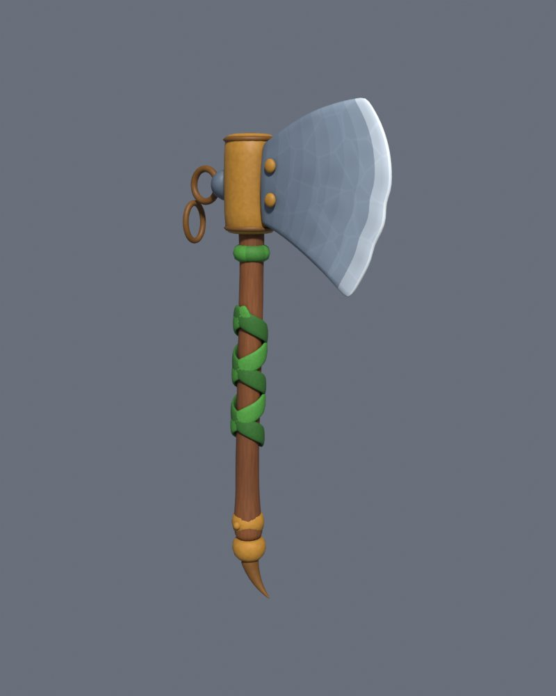
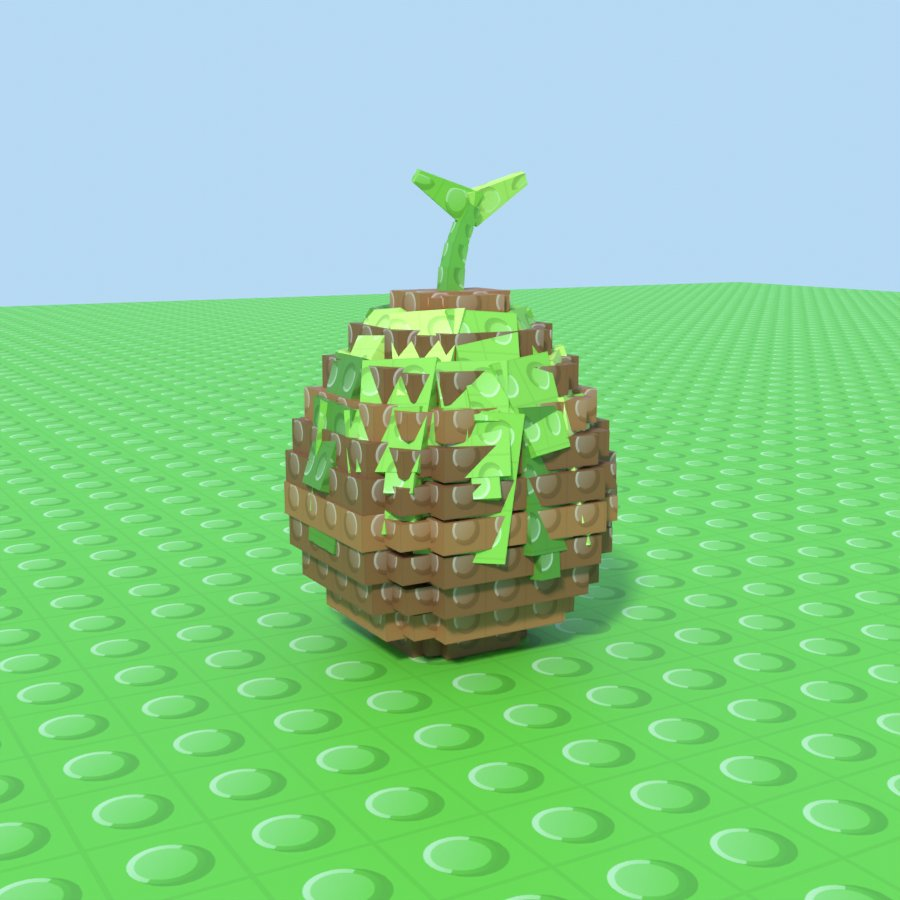
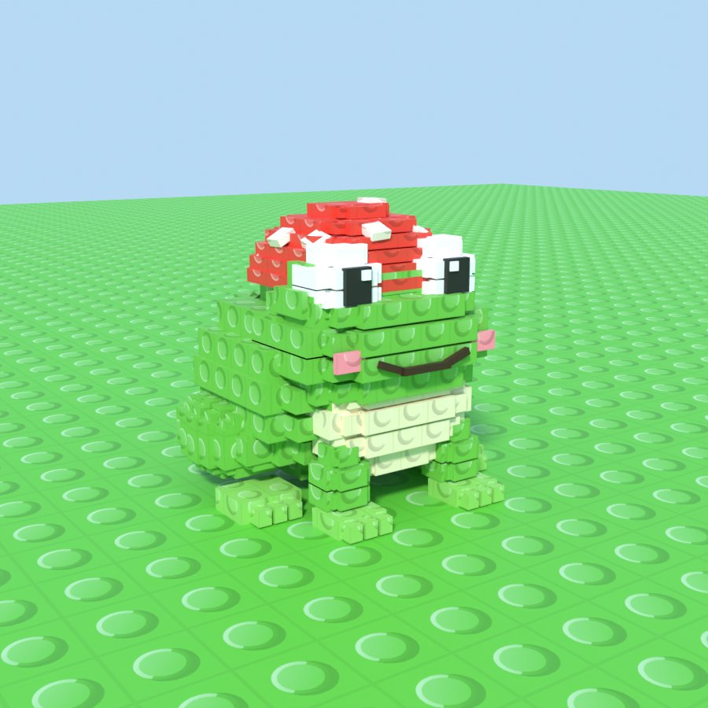

# Beginner guide: the starter set (axe, first egg, first monster)

| Mossbark Hatchet (starter axe) | Mossbark Egg | Mosscap Toad |
|---|---|---|
|  |  |  |

**The three assets:**

| Asset | Tier and rarity | Style |
|---|---|---|
| Mossbark Hatchet: the axe every player starts with | Wood, Common | Smooth cartoon look, like a hand-painted toy |
| Mossbark Egg: the most common egg | Wood, Common | Blocky, studded, like the reference monsters |
| Mosscap Toad: the first monster that hatches from it | Wood, Common | Blocky, studded, like the reference monsters |

This guide is written for someone who's never used Blender or Roblox Studio. If you already followed the [Frostmane guide](Guide_AddFrostmaneToRoblox.md), Parts 0, 2 and 4 will feel familiar. You can skip anything you've already done, such as installing the programs or creating `VFXLibrary`.

---

## Part 0: Get the tools and files
1. Install **Blender** 4.2 or newer from <https://www.blender.org/download/>, and **Roblox Studio** from <https://create.roblox.com/>.
2. Download this project from GitHub:
   1. Pick the branch **`claude/determined-einstein-mfy9yk`** from the branch button (top left).
   2. Click **Code**, then **Download ZIP**, then unzip it.

## Part 1: Make the files in Blender
1. Open Blender and click the **Scripting** tab at the top.
2. Click **Open** in the text area, pick **`blender/GenerateStarterSet.py`** from the project folder and click **Open Text**.
3. Optional, on Windows: **Window → Toggle System Console** to watch progress.
4. Click **▶ Run Script**, or press **Alt+P** with the mouse over the text.
5. **Wait 1–4 minutes.** Blender looks frozen while it paints the axe's texture and renders previews. That's normal.

The files go to `Documents/StarterSet/`:
- `MossbarkHatchet.glb` (the axe, with its painted textures built in)
- `MossbarkEgg.glb`
- `MosscapToad.glb`
- `MossbarkVFXMeshes.glb` (egg shell pieces for the hatch)
- a `Textures` folder with pictures to upload
- a `Previews` folder

✅ **Check:** open `Previews/MosscapToad.png` and you should see the toad.

## Part 2: Studio basics
1. Open Studio and open your game (or a **Baseplate**).
2. **File → Publish to Roblox**. Picture uploads only work for a published game.
3. On the **View** tab, switch on **Explorer**, **Properties**, **Output** and **Command Bar**.

## Part 3: Add the scripts
How to make a script object: in **Explorer**, hover over the place it should go, click **⊕**, choose the type, then right-click it, **Rename** it, double-click it to open, select everything inside, delete it, and paste the file's contents.

| Name (exact) | Type | Goes in | Paste this file |
|---|---|---|---|
| `VFXLibrary` | ModuleScript | ReplicatedStorage | `src/ReplicatedStorage/VFXLibrary.lua` |
| `StarterSet` | ModuleScript | ReplicatedStorage | `src/ReplicatedStorage/StarterSet.lua` |
| `StarterDemo` | Script | ServerScriptService | `src/ServerScriptService/StarterDemo.lua` |

**To swing the axe with the combo animations,** you also need the animation scripts from [PlayerAnimations.md](PlayerAnimations.md):
- `AnimationConfig`, a ModuleScript in ReplicatedStorage;
- `AnimationController`, a **LocalScript** in StarterPlayer → StarterPlayerScripts.

Without them the axe still works with Roblox's default tool hold.

If you already have `VFXLibrary` from the Frostmane guide, **replace its contents** with the newest file, which has more lines, and then paste your existing IDs back in.

## Part 4: Upload the pictures
1. Open **View → Asset Manager** and click **Bulk Import**.
2. Go to `Documents/StarterSet/Textures` and select these five files:
   - `StudOverlay.png`
   - `Spore.png`
   - `LeafBit.png`
   - `DustPuff.png`
   - `SwingStreak.png`

   You don't need to upload the `MossbarkHatchet_Head.png` and `MossbarkHatchet_Handle.png` files: they're already inside the axe's `.glb`.
3. In Asset Manager → **Images**, right-click each one, choose **Copy Asset ID**, and paste it into the matching line of `VFXLibrary`. For example, `Spore = "rbxassetid://123456789",`.

✅ **Check:** those five lines no longer say `rbxassetid://0`.

## Part 5: Import the models
Use **File → Import 3D** (in some Studio versions it's on the **Home** or **Avatar** tab). Keep the default settings and click **Import**. Import these four:

| File | Rename the model in Explorer to | Then |
|---|---|---|
| `MossbarkHatchet.glb` | `MossbarkHatchet` | Leave it in Workspace for now |
| `MossbarkEgg.glb` | `MossbarkEgg` | Leave it in Workspace and move it where you want with the Move tool |
| `MosscapToad.glb` | `MosscapToad` | Leave it in Workspace for now |
| `MossbarkVFXMeshes.glb` | `MossbarkVFXMeshes` | Drag it into a Folder called **`VFXMeshes`** in ReplicatedStorage. Create the folder with ⊕ → Folder if you don't have it yet |

## Part 6: Run the one-time setup
1. Make sure you're **not** playing (click **Stop** if you see it).
2. Paste this **one line** into the **Command Bar** and press **Enter**:
   ```lua
   local S = require(game.ReplicatedStorage.StarterSet); S.Assemble(workspace.MossbarkEgg, "Egg"); S.Assemble(workspace.MosscapToad, "Toad"); S.MakeTool(workspace.MossbarkHatchet)
   ```
3. **Output** should show three lines:
   - `Assembled MossbarkEgg`
   - `Assembled MosscapToad`
   - `Made Tool StarterPack.Mossbark Hatchet`
4. Drag **`MosscapToad`** from Workspace into **ServerStorage**. The demo makes a copy of it when the egg hatches.

✅ **Check:**
- The egg and toad now have their proper colours and little studs.
- **StarterPack** contains a Tool called **Mossbark Hatchet**.

## Part 7: Try it
1. Press **Play** (F5).
2. **The axe:** press **1** (or click it in the hotbar) to equip it, then click to swing. With the animation scripts installed you get the 4-hit combo.
3. **The egg:** walk to it and click it. It wobbles, bursts into shell pieces, leaves and dust, and the toad hops out next to it. After 10 seconds the egg resets.
4. Click **Stop** when you're done.

---

## Troubleshooting

| Problem | Fix |
|---|---|
| **The blade points backwards or sideways in your hand** | Open the `StarterSet` script and set `StarterSet.GRIP_YAW_DEGREES = 180` (or try `90` / `-90`). Then delete the Tool from StarterPack, import `MossbarkHatchet.glb` again and re-run the Part 6 line. |
| The hand holds the axe too high or low | Change `StarterSet.GRIP_FROM_BOTTOM` (in studs, from the bottom of the handle) and redo the step above. |
| `MakeTool: no part named Handle` | The imported model's parts were renamed. Expand it in Explorer: it should contain `Handle` and `Head`. |
| The axe looks grey or untextured | The import didn't bring the texture in. Re-import `MossbarkHatchet.glb` with **Upload to Roblox** switched on in the import window. |
| No studs on the egg or toad | `StudOverlay` isn't uploaded or pasted (Part 4). Then run the Part 6 line again. |
| `SurfaceAppearance needs Studio` | You ran the setup while playing. Stop and run it again. |
| `Infinite yield ... MosscapToad` | The toad must be in **ServerStorage**, named exactly `MosscapToad`. |
| Blender looks frozen | It's baking and rendering. Wait up to 4 minutes, or set `RENDER_PREVIEWS = False` near the top of the script for a faster run. |
| A red error in Blender | Open the text called `StarterSet_Log` in the text area's **Text** menu and send me the error. |

## Where to change numbers
- **Axe:** select the Tool in StarterPack, then look at **Properties → Attributes**: `Damage`, `StrengthPerClick`, `AttackSpeed` and so on.
- **Egg and toad:** select each model and look at its **Attributes**: hatch chance, cash per second and so on.
